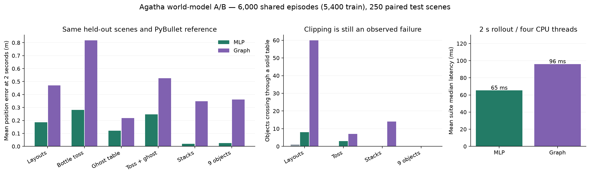

# World-model A/B experiment

**Keep the multi-step MLP as the default.** This graph-impulse implementation did not improve the measured forecasts. Both are genuinely trained models, and both remain selectable in the local demo. This comparison does not establish that graph networks in general are worse.



## What was trained

- Expanded the original 500-scene dataset to **5,000 randomized scenes / 300,000 scene transitions / 1,172,100 object transitions**. Generation: **401.73 seconds**. The larger one-step MLP trained for 40 epochs in **186.14 seconds**.
- Constructed one shared sequence dataset with those 5,000 scenes plus **1,000 extra toss/noclip scenes**: **6,000 episodes, 360,000 scene transitions**, 5,400 training scenes / 600 validation scenes. Extra cases: 334 bottle tosses, 333 disabled-table layouts, 333 tosses with disabled tables. Additional data generation: **38.98 seconds**.
- **A: MLP**, 79,373 parameters. Existing per-object features plus an explicit table-collision bit. Predicts pose residuals and next velocities.
- **B: graph impulses**, 40,646 parameters, three message-passing rounds with shared weights. Objects, finite table and floor are nodes; nearby pairs are edges. Predicts antisymmetric pair linear/angular impulses, then integrates. Equal-and-opposite linear impulses conserve internal pairwise linear momentum; gravity, damping and fixed supports are external influences. Full angular-momentum conservation is **not** implemented or claimed.
- Both A/B models trained **from scratch**, 30 epochs, identical scene splits, sampled windows, three-step autoregressive loss, training noise, optimizer and learning-rate schedule. Data-order seed 42, noise seed 991. **Checkpoint selection uses validation three-step loss**. Their capacities and compute costs differ; this is not a parameter-matched study.
- MLP training: **90.33 seconds**. Graph training: **341.31 seconds**. Four CPU threads. No pretrained dynamics weights and no PyBullet stepping in learned inference.

## Paired ordinary-scene comparison

All checkpoints evaluated on identical 200 held-out ordinary layouts, seed 20261115, 763 dynamic objects. The original 50-scene development test is retained separately in the selected checkpoint metrics. The expanded data and short-sequence training both help here.

| Model | 0.5 s error | 1 s error | 2 s error | Fall agreement |
| --- | ---: | ---: | ---: | ---: |
| Original 500-scene MLP | 0.073 m | 0.157 m | 0.266 m | 90.7% |
| 5,000-scene one-step MLP | 0.059 m | 0.109 m | 0.170 m | 93.8% |
| 6,000-scene multi-step MLP | 0.063 m | 0.101 m | 0.150 m | 94.8% |
| 6,000-scene graph impulses | 0.113 m | 0.248 m | 0.463 m | 84.1% |

The selected MLP reduces two-second position error by **43.6%** relative to the original checkpoint on this common test. These are synthetic development-held-out benchmarks, not blind real-world validation.

## Toss, noclip and stack stress tests

**250 paired held-out cases**: 100 ordinary layouts plus 30 cases each for bottle tosses, disabled-table layouts, tosses with disabled tables, six-object stacks and nine-object stacks. Each model gets the same initial state, masses, impulses, collision state and two-second horizon. Nine objects tests beyond the six-object training maximum.

Numbers below are mean position error in meters at **0.5 / 1 / 2 seconds**.

| Suite | Scenes | Multi-step MLP | Graph impulses |
| --- | ---: | ---: | ---: |
| layout | 100 | 0.084 / 0.143 / 0.186 | 0.126 / 0.275 / 0.470 |
| toss | 30 | 0.105 / 0.251 / 0.281 | 0.148 / 0.457 / 0.819 |
| noclip | 30 | 0.077 / 0.105 / 0.120 | 0.149 / 0.126 / 0.218 |
| toss_noclip | 30 | 0.105 / 0.226 / 0.247 | 0.004 / 0.139 / 0.526 |
| stacks | 30 | 0.011 / 0.014 / 0.019 | 0.086 / 0.193 / 0.348 |
| more_objects | 30 | 0.011 / 0.017 / 0.026 | 0.085 / 0.208 / 0.361 |

Bottles are **box approximations** with upward 3D impulses; there is no bottle mesh dynamics or water/fluid model. A disabled table remains visible as a ghost surface but exerts no support collision forces. Both learned models receive that explicit input; missing a support surface is not inferred from identical inputs.

## Clipping diagnostics

**Passing through a solid table is a model/solver failure. Passing through a deliberately disabled table is the requested counterfactual.** We do not count the latter as penetration error.

The penetration diagnostic samples 27 points in each oriented box and checks whether they enter the finite table slab more than 5 mm below its top. This is a geometric approximation and can miss some intersections. Separately we count objects whose center crosses from above to below the entire solid table while still over its footprint. Each metric is also measured on the PyBullet reference.

| Solid-table suite | MLP frame fraction / crossed objects | Graph frame fraction / crossed objects | PyBullet frame fraction / crossed objects |
| --- | ---: | ---: | ---: |
| layout | 29.7% / 8 | 21.6% / 60 | 0.6% / 1 |
| toss | 28.5% / 3 | 3.2% / 7 | 0.2% / 0 |
| stacks | 1.7% / 0 | 3.5% / 14 | 0.0% / 0 |
| more_objects | 0.3% / 0 | 2.4% / 0 | 0.0% / 0 |

**Low penetration-frame frequency alone can be misleading:** an object that passes completely through the table quickly may spend few frames in the slab. The graph's lower frequency in some suites does not compensate for its more frequent complete crossings. Clipping is **not solved** by either learned model. The diagnostic also flags one PyBullet crossing; that can reflect solver behavior or the approximation in the geometric check.

## Fall precision and recall

| Suite | Model | Agreement | Precision | Recall |
| --- | --- | ---: | ---: | ---: |
| layout | mlp_multistep | 94.4% | 79.2% | 77.6% |
| layout | graph_impulse | 84.2% | 41.7% | 51.0% |
| toss | mlp_multistep | 80.0% | 71.4% | 83.3% |
| toss | graph_impulse | 56.7% | 48.0% | 100.0% |
| noclip | mlp_multistep | 99.2% | 99.2% | 100.0% |
| noclip | graph_impulse | 98.4% | 98.4% | 100.0% |
| toss_noclip | mlp_multistep | 100.0% | 100.0% | 100.0% |
| toss_noclip | graph_impulse | 100.0% | 100.0% | 100.0% |

For suites with no true falls, recall is undefined (null in the raw JSON), not represented as perfect accuracy. Both candidates produced finite positions within 10 m in **250/250 cases**. This stability criterion does not establish collision accuracy. Per-suite stability and end-to-end inference latency are recorded in the full results. The latency plot averages the six suite medians. Both candidates run faster than real time in this run; the graph is slower than the MLP. Timings are approximate and were not measured on an otherwise idle host.

## Try it

Start the API using the README instructions. Click **Load bottle experiment**, choose **A / Multi-step MLP** or **B / Graph impulses**, and run the upward toss. Uncheck **Solid table collisions** and run again to see the deliberate counterfactual. Every run restarts the initial scene.

The existing `/api/simulate` endpoint accepts `learned_architecture`: `default`, `mlp_multistep` or `graph_impulse`. Existing `engine` values remain `physics`, `learned`, `both`.

```json
{
  "scene_id": "use the ID returned by POST /api/scenes/demo?scenario=bottle",
  "engine": "both",
  "learned_architecture": "mlp_multistep",
  "actions": [
    {"type":"push","id":"bottle","direction":[0,1,0],"impulse_Ns":1.5},
    {"type":"set_support_collisions","enabled":false}
  ]
}
```

Original `[x,z]` pushes remain supported. `[x,y,z]` enables an upward toss. No initial velocities or outcomes are fabricated; the same impulse is applied to physics and the learned initial state.

## Reproduce

```bash
.venv/bin/python scripts/generate_data.py --scenes 5000 --seed 2026
.venv/bin/python scripts/prepare_ab_data.py --extra 1000
.venv/bin/python scripts/train_ab.py --kind mlp_multistep --output models/mlp_multistep.pt --epochs 30 --samples-per-scene 2
.venv/bin/python scripts/train_ab.py --kind graph_impulse --output models/graph_impulse.pt --epochs 30 --samples-per-scene 2
.venv/bin/python scripts/benchmark_ab.py --mlp models/mlp_multistep.pt --graph models/graph_impulse.pt
.venv/bin/python scripts/plot_ab_results.py
```

Raw measured results: [ab_results.json](../models/ab_results.json). Same-200-scene before/after results: [retraining_comparison.json](../models/retraining_comparison.json). Checkpoints and per-model training recipes are in `models/`.

This implements and tests the proposal in `NOTES.md`; it is an adaptation of established graph-simulator ideas, with no claim of original research novelty. Related primary papers: [Allen et al., rigid-contact graph simulators](https://proceedings.mlr.press/v205/allen23a.html), [Sanchez-Gonzalez et al., GNS](https://arxiv.org/abs/2002.09405), [Sharma and Fink, Dynami-CAL](https://arxiv.org/abs/2501.07373). Their published results are not evidence for this implementation's accuracy; only the measurements above are used here.
